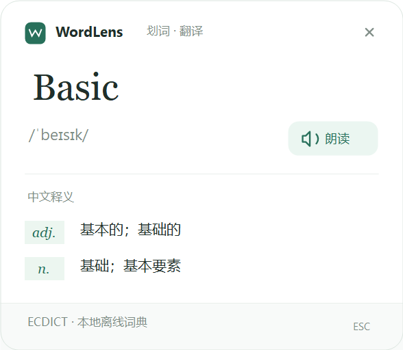
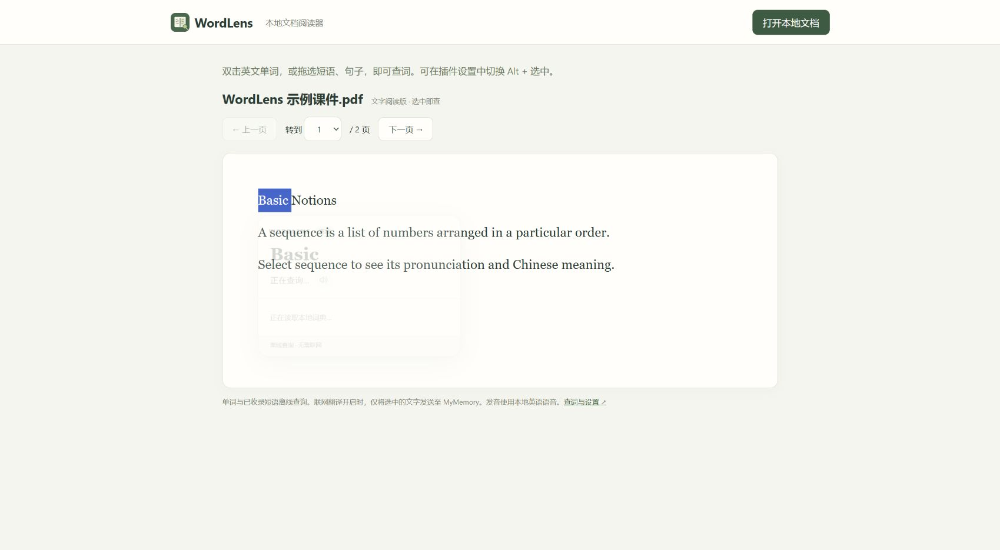

# WordLens 划词词典与翻译

> 1.3.7 开发版进一步修复 HTML 朗读重复卡片：网页卡片存续期间持续登记，主动取消辅助浮窗及迟到提示；保留可选的“单词自动朗读”（默认关闭）。Windows 组件仍为 1.3.4，无需重新安装。PDF 原排版阅读模式及 TeX 合字修正仍在草稿中；Edge 内置查看器的错词与延迟尚未确认解决。正式发布版仍为 1.3.2。

Chrome / Microsoft Edge 浏览器扩展。选中英文单词、短语或句子，在原文旁边查看音标、中文释义或翻译，也可以听英语朗读。

## 功能

- **单词**：离线音标、中文释义和英语朗读。
- **短语**：优先查询内置短语词库，未收录时可联网翻译。
- **句子**：英文 → 简体中文翻译及本地英语朗读，单次最多 2000 字符。
- **本地 HTML**：支持 `file:///` 文件，需在扩展详情开启“允许访问文件 URL”。
- **本地文档**：在插件面板点击“打开本地文档”。PDF 可保留原排版、公式与图形并划词；PPTX、Word（DOCX）、TXT、Markdown、CSV 等支持文字阅读与划词。
- **右键查词**：在提供扩展右键菜单的页面上，选中文字后右键选择“用 WordLens 查词 / 翻译所选文字”。
- 支持 Alt + 选中、关闭自动浮窗、工具栏手动查询和英美口音偏好。
- **单词自动朗读**：在面板“阅读偏好”中自行开启或关闭，默认关闭并记住选择。开启后成功查到单词便朗读所选原词，适用于网页、本地阅读器、原页面增强和面板查询。短语、句子仍手动朗读，未安装本地英语语音时保留释义并提示。

内置 **399,213 个单词、357,828 个短语**，无需构建、账号或 API Key。






## 安装

### 使用安装包

1. 从 [Releases](../../releases) 下载 `WordLens-1.3.2.zip`，全部解压到固定目录。
2. 打开 `edge://extensions` 或 `chrome://extensions`，开启**开发者模式**。
3. 点击**加载已解压的扩展程序**，选择包含 `manifest.json` 的 **wordlens** 文件夹。
4. 刷新已打开的网页，再双击单词或拖选短语、句子。

### 从源码安装

下载或克隆此仓库，在浏览器扩展管理页面加载仓库中的 **extension** 文件夹即可。不需要 npm install 或打包步骤。

### 本地 HTML 文件

在 WordLens 的**详细信息**中开启**允许访问文件 URL**，然后刷新 HTML 文件。工具栏面板会显示该权限是否开启，并提供扩展详情入口。

更新时覆盖原扩展文件夹，在扩展管理页面点击**重新加载**，再刷新网页。不要删除或移动浏览器正在加载的文件夹。

## 使用

选中即查；点击空白、按 Esc 或滚动页面关闭浮窗。在面板中输入单词、短语或句子，Enter 查询，Shift + Enter 换行。“网页划词 / 划句”只控制自动浮窗，手动查询始终可用。

短语有词典音标时显示音标；句子提供翻译和英语朗读。朗读需要系统安装本地英语语音包，音标不会随口音偏好变化。

### 保留原页面和排版查词（Windows）

面板的“查词模式”可选择 **选中即查、快捷键查词、右键查词、复制查词（PDF 兼容）**。PDF 取词不准或响应慢时，开启原页面增强并选择复制模式，选中英文后按 **Ctrl+C**，浮窗查询复制出的原文。此模式需要复制动作，不能只双击选中，也不用 Alt+W。标准快捷键模式仍使用 **Alt+W**。

Edge 内置 PDF 等页面无法注入内容脚本，可安装随包附带的 Windows 辅助组件：

1. 更新 / 重新加载扩展，打开面板中的 **安装 / 使用帮助**。
2. 双击 `wordlens/native/WordLens.Native.exe`，把面板显示的扩展 ID 粘贴进去，点击 **安装 / 更新**。
3. 在插件面板开启 **原页面增强（Windows）**，选择 **选中即查** 或 **快捷键查词**。原文档不转换，也不切换到文字阅读器。
4. 暂不需要组件时关闭该开关。再次运行辅助程序可移除浏览器通信注册。

升级到 1.3.4 测试版时，先关闭增强以退出旧辅助程序，安装新版组件，再重新加载扩展、开启增强并重新连接。通过源码或本地测试包使用 1.3.4；上方 Releases 安装步骤仍指向正式版。取词固定鼠标松开的位置，校验选区矩形和文字范围；普通未就绪情况最多读取三次，位置不符时最多五次。读取超时后组件最多自动重启两次，成功显示后恢复重试额度；连续失败时提示手动重新连接。查找限于当前命中的文档容器，设置节点、深度和时间上限，只读取选中的范围。

标准模式通过 Windows 无障碍接口读取前台 Edge、Chrome、PowerPoint 或 WPS 的当前选区，不读取剪贴板。复制模式须主动选择，仅在识别到前台支持应用的 Ctrl+C、新的剪贴板序号且复制来源属于同一进程后，限时读取这次复制的纯文本；不读取历史、不改写剪贴板、不自动模拟复制。仅识别复制组合键，不记录键盘文字。没有整份文档上传或开机自启动，与插件断开即退出；通信主机只注册当前用户和指定的扩展 ID。

面板区分“通信已连接”和“读取选区 / 已显示释义”；未提供文字层、空选区、受保护控件、读取超时会显示相应状态。本机 `%LOCALAPPDATA%/WordLens/native-status.json` 仅保存一份覆盖更新的诊断状态（版本、原因、次数、节点 / 提供器计数），不含选中文字、文件名、URL 或窗口标题，不是查询历史。

**支持取决于原查看器是否暴露选区**。扫描图片、受保护文件或未暴露文字的 Canvas 不保证可用；右键入口也取决于查看器是否提供扩展菜单。用户曾确认 1.3.2 的新界面与关闭后重查正常，随后反馈 PDF 浮窗不出现和取词不符；本次修复仍待实际 PDF 复测。其他 Office / WPS 查看器和版本仍取决于其选区支持情况。

### 在 Edge 中阅读本地 PPT / PDF / Word

1. 点击工具栏的 **WordLens → 打开本地文档**。
2. 在阅读器中再次点击 **打开本地文档**，选择电脑中的文件。阅读器的文件选择不需要开启“允许访问文件 URL”。
3. PDF 默认使用 **原排版 · 精准划词**，可缩放或切换 **文字阅读版**。双击单词或拖选英文短语、句子；PPTX / PDF 可翻页或按页码跳转。

| 文件 | 支持方式 |
| --- | --- |
| PPTX | 按演示文稿顺序提取每页文字，包括文字型表格；保留无文字页的位置 |
| PDF | 原排版模式保留公式、图形和版式，以可选文字层取词；也可切换文字阅读版，支持示例试读 |
| DOCX | 按段落与表格中的文字顺序阅读，不推测 Word 的分页 |
| TXT、MD、CSV、TSV、LOG、JSON、XML、TEX | UTF-8 或带 BOM 的 UTF-16 纯文本阅读 |
| 旧版 PPT / DOC | 请先在 PowerPoint / Word / WPS 中另存为 PPTX / DOCX，或导出为含文字的 PDF |
| XLSX / XLS、ODP / ODT 等 | 请先导出为 CSV 或含文字的 PDF |

PDF 原排版模式绘制原页，文字层用于选区查词，不修改原文件。标准 Unicode 合字会展开；TeX 控制编码仅在页面绘制字体与字符证据一致时修正，未知编码不猜测。阅读器内直接选词，无需 Windows 辅助组件，也不受面板“复制 / 快捷键”模式限制；网页划词总开关与 Alt 触发偏好仍有效。

PPTX / DOCX 和 PDF 的**文字阅读版**可能丢失图片、复杂公式、版式及多栏阅读顺序。扫描 PDF、图片中的文字暂不做 OCR；PDF 原排版模式可显示此类页面，但没有可选文字时会明确提示。暂不支持加密文档，单文件最大 50 MB，PPTX / PDF 最多 2000 页；内容过多时请拆分。

Edge 内置 PDF 查看器或网页 Office 查看器可能不允许注入网页浮窗。Windows 可开启上述“原页面增强”；文字阅读器和原查看器提供的扩展右键菜单也保留为可选入口。

### 浏览器没有识别到本地英语语音

在 Windows 打开**设置 → 时间和语言 → 语音 → 管理语音 → 添加语音**，选择**英语（美国）**或**英语（英国）**，等待下载完成，再彻底退出并重新打开 Edge / Chrome。在插件面板点击**重新检查**与**测试发音**。浏览器仍在后台运行时，可从任务栏通知区域退出，或重启电脑。

已有 **Microsoft Zira Desktop** 不一定代表浏览器能使用英语：Chromium 在 Windows 优先读取现代 OneCore 语音目录，旧 SAPI 目录中的语音可能不会列出。只安装英语键盘或语音识别也不等于安装了英语文本转语音。参见[微软安装说明](https://support.microsoft.com/en-us/accessibility/windows/narrator/appendix-a-supported-languages-and-voices)与[Chromium 语音实现](https://github.com/chromium/chromium/blob/main/content/browser/speech/tts_win.cc)。

语音检查会重试尚未初始化的语音列表，支持明确标记为本地的扩展语音引擎，并区分列表读取失败与没有英语语音。扩展不会自动改用在线语音服务。

## 网络与隐私

单词和已收录短语完全离线查询。联网翻译默认开启，可在面板关闭；未收录的短语和句子通过 [MyMemory](https://mymemory.translated.net/doc/spec.php) 翻译，**只发送选中或输入的文字**，不发送整页、网页地址、周围上下文或 Cookie。

MyMemory 有免费使用限额，网络不可用、超时或额度用尽时会明确提示。第三方服务的数据处理规则以其条款为准。扩展不保存查词历史，无跟踪或分析统计；少量翻译缓存只存在后台内存，关闭联网翻译会清除缓存并取消未完成请求。

本地文档由随扩展附带的解析代码在本机读取，**不上传整份文件**，不执行文档脚本或加载文档中的外部链接。仅查询文字可能交给可关闭的联网翻译。右键查询通过扩展会话存储临时传递所选文字，读取后立即删除，超过两分钟视为过期，不把文字放进地址栏；不持久保存。

## 兼容性与限制

网页划词支持 Chrome / Edge 114+ 的普通网页、本地 HTML 和允许内容脚本运行的 iframe；本地文档阅读建议使用当前版本的 Edge / Chrome。输入框和富文本编辑区域不会触发浮窗。浏览器设置页、扩展商店、内置 PDF 阅读器和 Canvas 文字不支持直接注入浮窗，可使用插件阅读器、可用的扩展右键菜单或面板手动查询。

## 项目结构

- `extension/`：可直接加载的 Manifest V3 扩展，包含完整压缩词库。
- `tests/`：Node.js 核心、翻译、本地语音、文档解析和右键查询测试。
- `scripts/package.py`：生成与 Releases 相同结构的安装 ZIP。
- `native/`：Windows 选区读取、原生浮窗、通信协议与安装器的 C# 源码。
- `scripts/build-native.ps1`：使用 Windows 自带 .NET Framework 编译器构建辅助组件，无需额外 .NET SDK。
- `docs/images/`：功能示例截图。

开发验证（Node.js 22.13+，建议 Node.js 24）：

```sh
npm ci --ignore-scripts
npm test
```

生成安装包（Python 3）：

```sh
python scripts/package.py
```

打包输出到 `dist/WordLens-1.3.7.zip`。用户安装插件不需要这些开发依赖。

## 数据来源与授权

扩展源码采用 [MIT License](LICENSE)。英汉词库来自 [skywind3000/ECDICT](https://github.com/skywind3000/ECDICT)，上游授权完整保存在 [ECDICT-LICENSE.txt](extension/ECDICT-LICENSE.txt)。词库条目数量、格式与原始文件 SHA-256 见 [metadata.json](extension/data/metadata.json)。

词典按前两个字母拆分并 gzip 压缩，仅按需解压相关分片。

PDF 提取使用本地附带的 Mozilla PDF.js 6.4.299（Apache-2.0），其许可、CMap 和字体许可完整保留。参见 [第三方声明](extension/THIRD_PARTY_NOTICES.md)。
